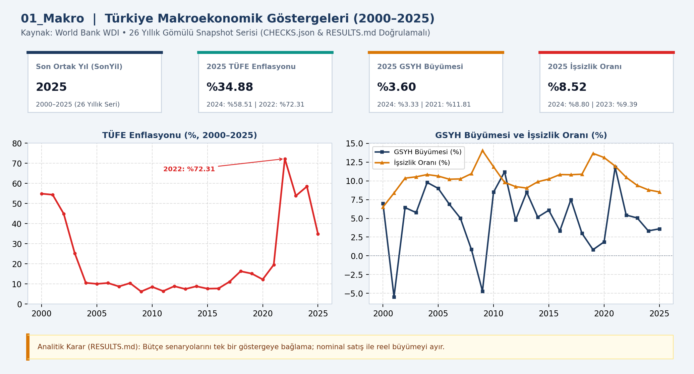
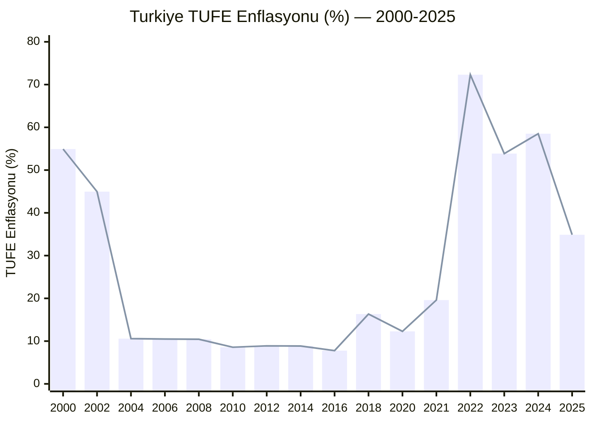
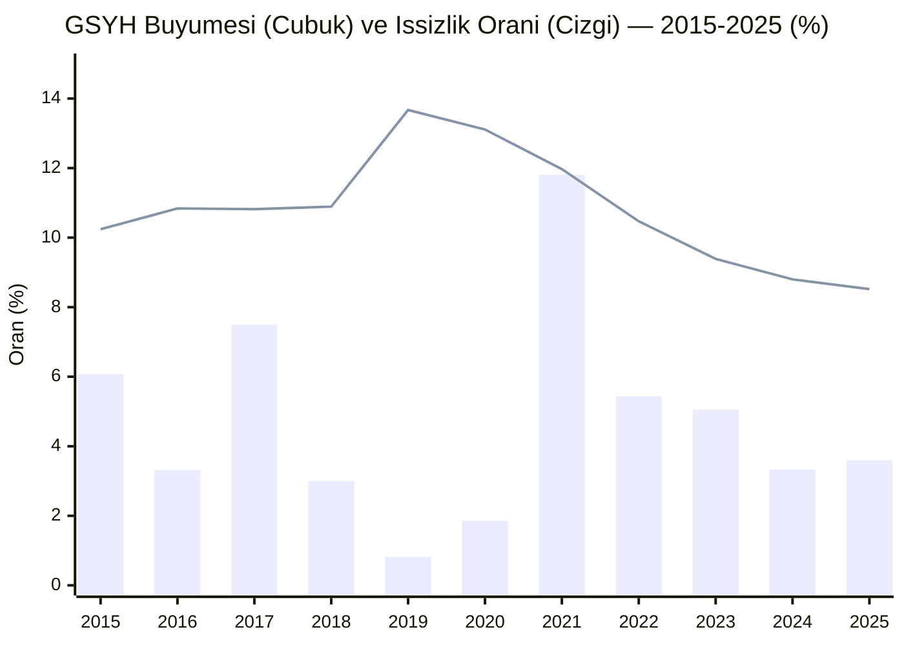

# 📊 01_Makro — Türkiye Makroekonomik Göstergeleri Raporu (2000–2025)

Bu rapor, Dünya Bankası (**World Bank WDI**) verileri üzerinden Türkiye'nin 2000–2025 dönemine ait 26 yıllık **TÜFE Enflasyonu (%)**, **GSYH Büyümesi (%)** ve **İşsizlik Oranı (%)** göstergelerini inceler.

---

## 📌 Temel KPI Kartları (`CHECKS.json` & `RESULTS.md`)

| Son Ortak Yıl (`SonYil`) | 2025 TÜFE Enflasyonu (`Enflasyon`) | 2025 GSYH Büyümesi (`Buyume`) | 2025 İşsizlik Oranı (`Issizlik`) |
| :---: | :---: | :---: | :---: |
| **2025** | **%34.88** | **%3.60** | **%8.52** |
| *26 Yıllık Seri (2000–2025)* | *2022 Zirvesi: %72.31* | *2021 Zirvesi: %11.81* | *2009 Zirvesi: %14.04* |

---

## 📈 Grafik 1: TÜFE Enflasyonu Seyri (2000–2025, %)

## 📈 Grafik 2: GSYH Büyümesi (%) ve İşsizlik Oranı (%) Karşılaştırması (2015–2025)

---

## 📋 2000–2025 Tam Veri Tablosu (`SNAPSHOT.json`)

| Yıl | TÜFE Enflasyonu (%) | GSYH Büyümesi (%) | İşsizlik Oranı (%) | Enflasyon Yoğunluk Göstergesi |
| :---: | :---: | :---: | :---: | :--- |
| **2025** | **%34.881** | **%3.605** | **%8.520** | `██████████░░░░░░░░░░` |
| **2024** | %58.506 | %3.328 | %8.800 | `████████████████░░░░` |
| **2023** | %53.859 | %5.045 | %9.388 | `███████████████░░░░░` |
| **2022** | %72.309 | %5.441 | %10.465 | `████████████████████` |
| **2021** | %19.596 | %11.811 | %11.969 | `█████░░░░░░░░░░░░░░░` |
| **2020** | %12.279 | %1.860 | %13.109 | `███░░░░░░░░░░░░░░░░░` |
| **2019** | %15.177 | %0.819 | %13.665 | `████░░░░░░░░░░░░░░░░` |
| **2018** | %16.332 | %3.004 | %10.887 | `████░░░░░░░░░░░░░░░░` |
| **2017** | %11.144 | %7.502 | %10.819 | `███░░░░░░░░░░░░░░░░░` |
| **2016** | %7.775 | %3.323 | %10.838 | `██░░░░░░░░░░░░░░░░░░` |
| **2015** | %7.671 | %6.084 | %10.237 | `██░░░░░░░░░░░░░░░░░░` |
| **2014** | %8.855 | %5.167 | %9.880 | `██░░░░░░░░░░░░░░░░░░` |
| **2013** | %7.493 | %8.486 | %9.043 | `██░░░░░░░░░░░░░░░░░░` |
| **2012** | %8.892 | %4.789 | %9.227 | `██░░░░░░░░░░░░░░░░░░` |
| **2011** | %6.472 | %11.200 | %9.795 | `██░░░░░░░░░░░░░░░░░░` |
| **2010** | %8.566 | %8.487 | %11.879 | `██░░░░░░░░░░░░░░░░░░` |
| **2009** | %6.251 | -%4.704 | %14.040 | `██░░░░░░░░░░░░░░░░░░` |
| **2008** | %10.444 | %0.847 | %10.963 | `███░░░░░░░░░░░░░░░░░` |
| **2007** | %8.756 | %5.034 | %10.256 | `██░░░░░░░░░░░░░░░░░░` |
| **2006** | %10.493 | %6.886 | %10.219 | `███░░░░░░░░░░░░░░░░░` |
| **2005** | %10.057 | %8.995 | %10.638 | `███░░░░░░░░░░░░░░░░░` |
| **2004** | %10.583 | %9.791 | %10.840 | `███░░░░░░░░░░░░░░░░░` |
| **2003** | %25.296 | %5.774 | %10.540 | `███████░░░░░░░░░░░░░` |
| **2002** | %44.964 | %6.436 | %10.358 | `████████████░░░░░░░░` |
| **2001** | %54.400 | -%5.459 | %8.381 | `███████████████░░░░░` |
| **2000** | %54.915 | %6.985 | %6.495 | `███████████████░░░░░` |

---

## 🎯 Analitik Karar ve Metodolojik Not (`analysis_evidence/RESULTS.md`)
- **Karar Kuralı:** Kurumsal bütçe ve finansal planlama senaryolarını tek bir makro göstergeye bağlamayın; yüksek enflasyon dönemlerinde nominal satış artışı ile reel büyümeyi birbirinden ayırın.
- **Model Yapısı (`01_Makro.SemanticModel`):** 1 Tablo (`Macro`), 4 Sütun (`year`, `inflation`, `gdp_growth`, `unemployment`) ve 4 DAX Ölçüsü (`SonYil`, `Enflasyon`, `Buyume`, `Issizlik`).
