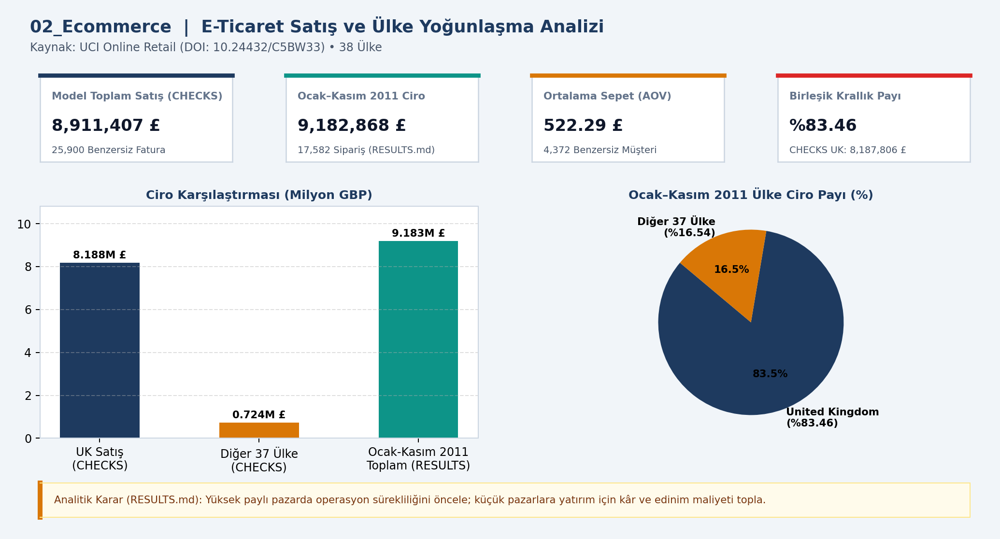
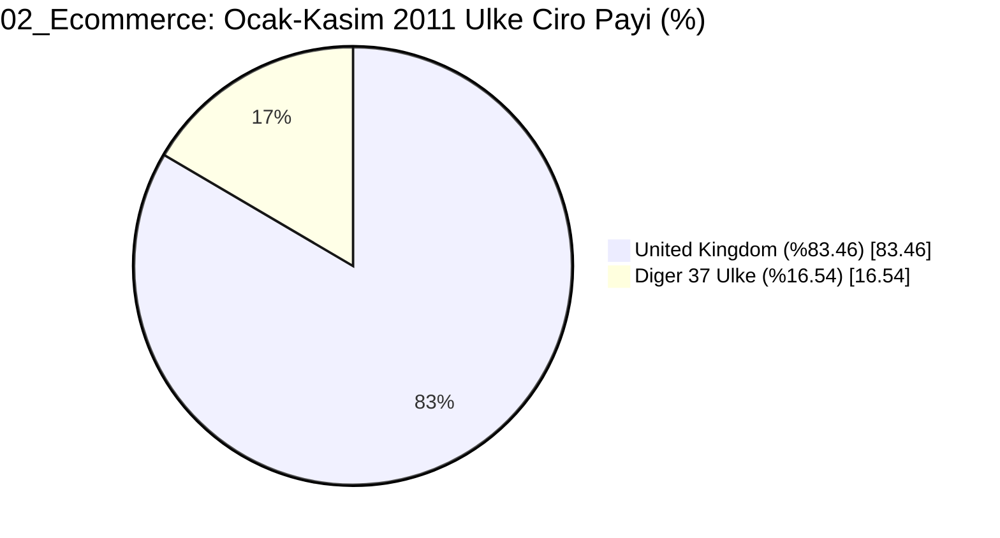

# 📊 02_Ecommerce — E-ticaret satış analizi

## 📌 Proje Özeti ve KPI Doğrulaması (`CHECKS.json` & `RESULTS.md`)
- **Veri Kaynağı ve Kapsam:** UCI Online Retail (38 Ülke)
- **Temel KPI ve Doğrulama Bulgusu:** Model satış: 8,911,407.39 GBP (25,900 fatura); Ocak–Kasım 2011 ciro: 9,182,867.74 GBP (17,582 sipariş, AOV 522.29 GBP, UK payı %83.46).
- **Analitik Karar Kuralı:** Yüksek paylı pazarda operasyon sürekliliğini öncele; küçük pazarlara yatırım kararı için kâr ve edinim maliyeti topla.

## 📈 Etkileşimli Grafik Görünümü (GitHub Mermaid)

## 📁 Klasör Bileşenleri
- `dashboard.png`: Yüksek çözünürlüklü Power BI gösterge paneli çıktısı
- `data/`: Modele aktarılan CSV veri tabloları
- `analysis_evidence/`: `METHOD.md`, `RESULTS.md` ve `summary.json` kanıt dosyaları
- `CHECKS.json`: Beklenen KPI kart değerleri ve şema doğrulama sonuçları
- `02_Ecommerce.pbip`, `02_Ecommerce.Report/`, `02_Ecommerce.SemanticModel/`: Power BI proje ve veri modeli dosyaları
