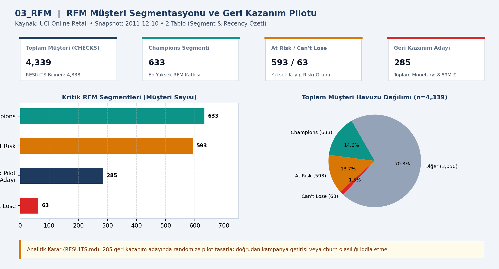
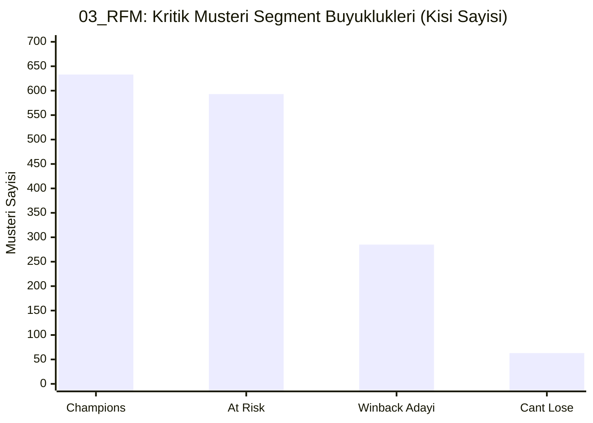

# 📊 03_RFM — RFM müşteri segmentleri

## 📌 Proje Özeti ve KPI Doğrulaması (`CHECKS.json` & `RESULTS.md`)
- **Veri Kaynağı ve Kapsam:** UCI Online Retail (2011-12-10)
- **Temel KPI ve Doğrulama Bulgusu:** 4,339 müşteri (toplam 8,887,208.89 GBP): 633 Champions, 593 At Risk, 63 Can't Lose; 285 geri kazanım pilot adayı.
- **Analitik Karar Kuralı:** 285 geri kazanım adayında randomize kontrollü bir geri kazanım pilotu tasarla; önceden churn olasılığı iddia etme.

## 📈 Etkileşimli Grafik Görünümü (GitHub Mermaid)

## 📁 Klasör Bileşenleri
- `dashboard.png`: Yüksek çözünürlüklü Power BI gösterge paneli çıktısı
- `data/`: Modele aktarılan CSV veri tabloları
- `analysis_evidence/`: `METHOD.md`, `RESULTS.md` ve `summary.json` kanıt dosyaları
- `CHECKS.json`: Beklenen KPI kart değerleri ve şema doğrulama sonuçları
- `03_RFM.pbip`, `03_RFM.Report/`, `03_RFM.SemanticModel/`: Power BI proje ve veri modeli dosyaları
