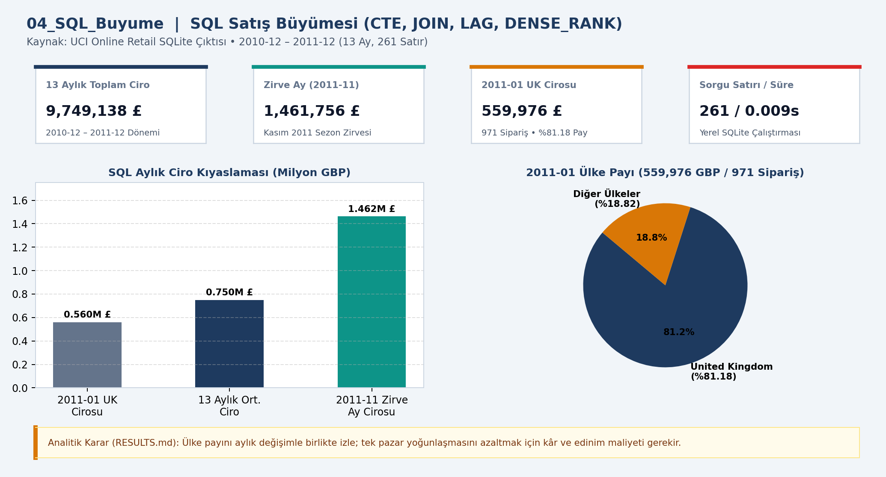
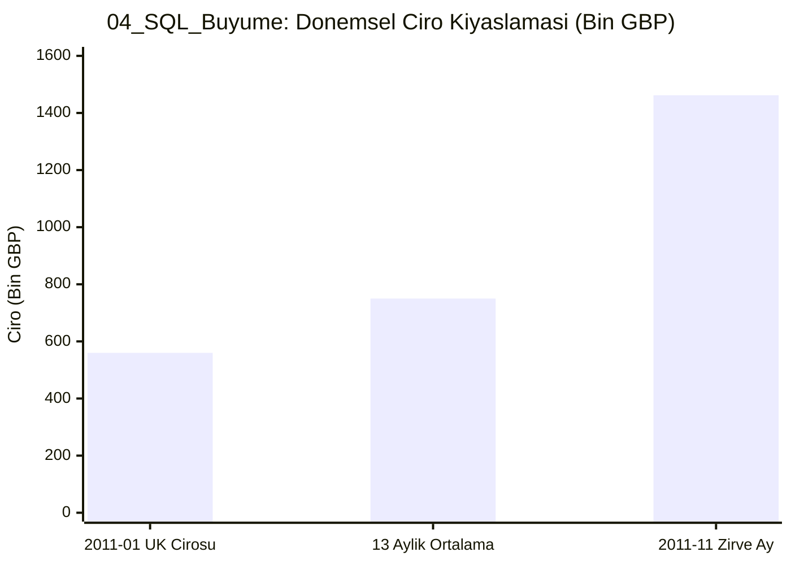

# 📊 04_SQL_Buyume — SQL satış büyümesi

## 📌 Proje Özeti ve KPI Doğrulaması (`CHECKS.json` & `RESULTS.md`)
- **Veri Kaynağı ve Kapsam:** UCI Online Retail SQLite (13 Ay)
- **Temel KPI ve Doğrulama Bulgusu:** 2010-12 – 2011-12 (13 ay) toplam 9,749,138.20 GBP ciro; zirve ay 2011-11 (1,461,756.24 GBP); 261 satır (0.009 sn).
- **Analitik Karar Kuralı:** Ülke payını aylık değişimle birlikte izle; tek pazar yoğunlaşmasını azaltmak için ülke bazlı kâr ve edinim maliyeti gerekir.

## 📈 Etkileşimli Grafik Görünümü (GitHub Mermaid)

## 📁 Klasör Bileşenleri
- `dashboard.png`: Yüksek çözünürlüklü Power BI gösterge paneli çıktısı
- `data/`: Modele aktarılan CSV veri tabloları
- `analysis_evidence/`: `METHOD.md`, `RESULTS.md` ve `summary.json` kanıt dosyaları
- `CHECKS.json`: Beklenen KPI kart değerleri ve şema doğrulama sonuçları
- `04_SQL_Buyume.pbip`, `04_SQL_Buyume.Report/`, `04_SQL_Buyume.SemanticModel/`: Power BI proje ve veri modeli dosyaları
