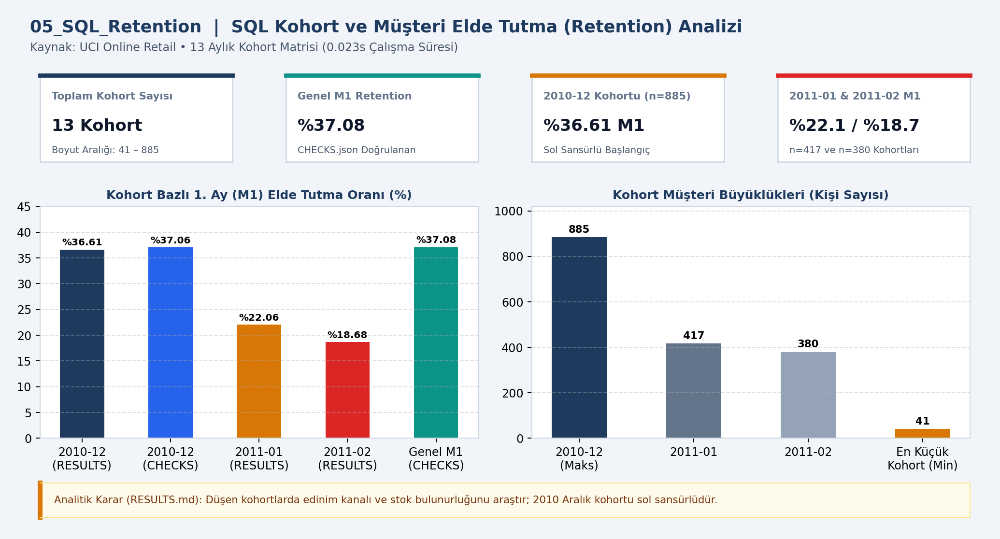
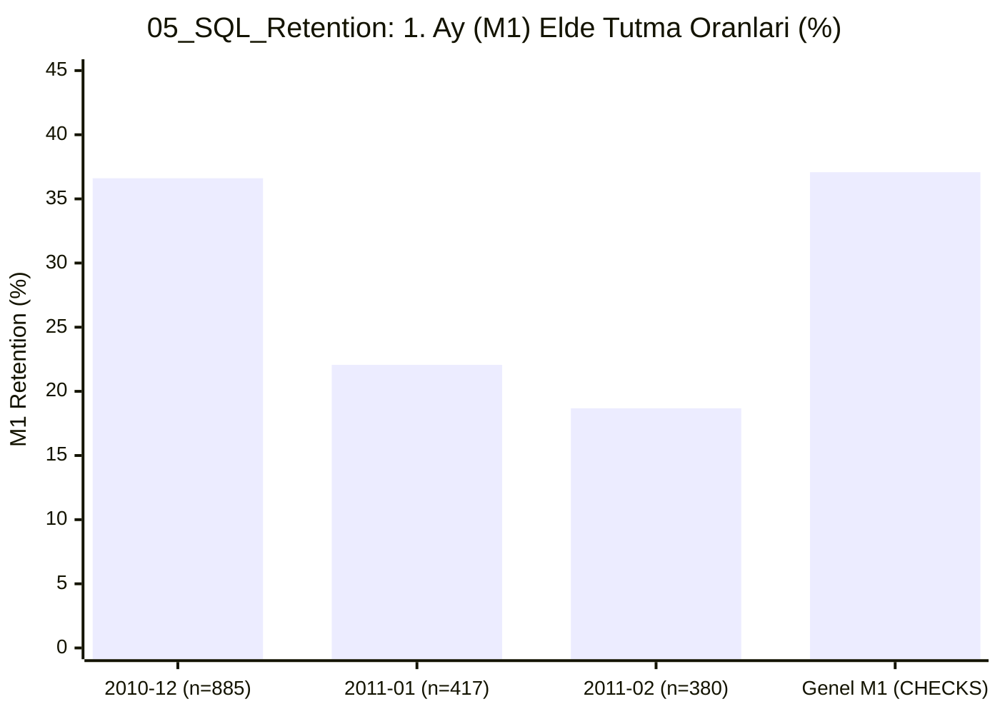

# 📊 05_SQL_Retention — SQL kohort ve retention

## 📌 Proje Özeti ve KPI Doğrulaması (`CHECKS.json` & `RESULTS.md`)
- **Veri Kaynağı ve Kapsam:** UCI Online Retail (13 Kohort)
- **Temel KPI ve Doğrulama Bulgusu:** 13 kohort (min 41 – maks 885 müşteri); genel M1 elde tutma %37.08; 2010-12 M1 %36.61, 2011-01 M1 %22.06, 2011-02 M1 %18.68.
- **Analitik Karar Kuralı:** Küçük veya düşen kohortlarda edinim kanalı ve stok bulunurluğunu araştır; 2010 Aralık kohortu sol sansürlüdür.

## 📈 Etkileşimli Grafik Görünümü (GitHub Mermaid)

## 📁 Klasör Bileşenleri
- `dashboard.png`: Yüksek çözünürlüklü Power BI gösterge paneli çıktısı
- `data/`: Modele aktarılan CSV veri tabloları
- `analysis_evidence/`: `METHOD.md`, `RESULTS.md` ve `summary.json` kanıt dosyaları
- `CHECKS.json`: Beklenen KPI kart değerleri ve şema doğrulama sonuçları
- `05_SQL_Retention.pbip`, `05_SQL_Retention.Report/`, `05_SQL_Retention.SemanticModel/`: Power BI proje ve veri modeli dosyaları
