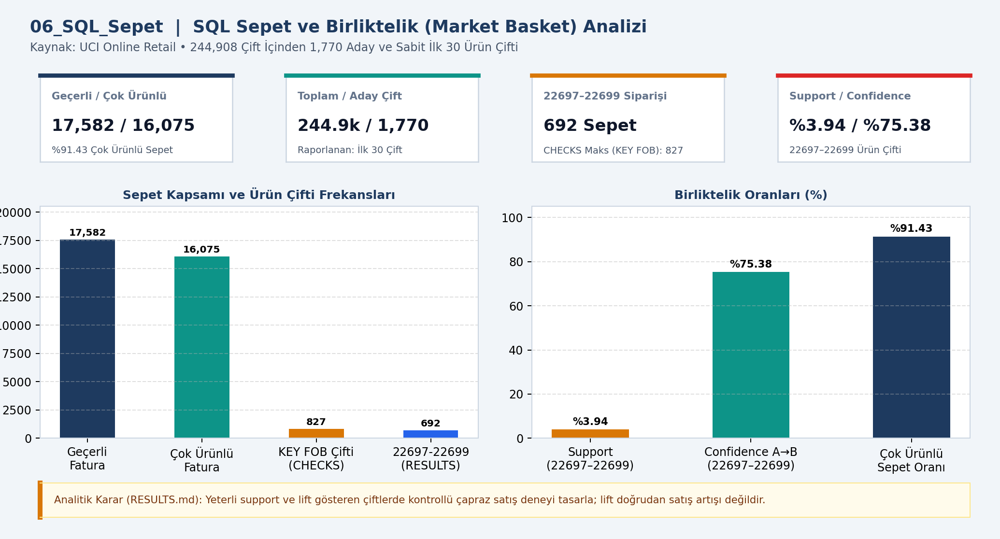
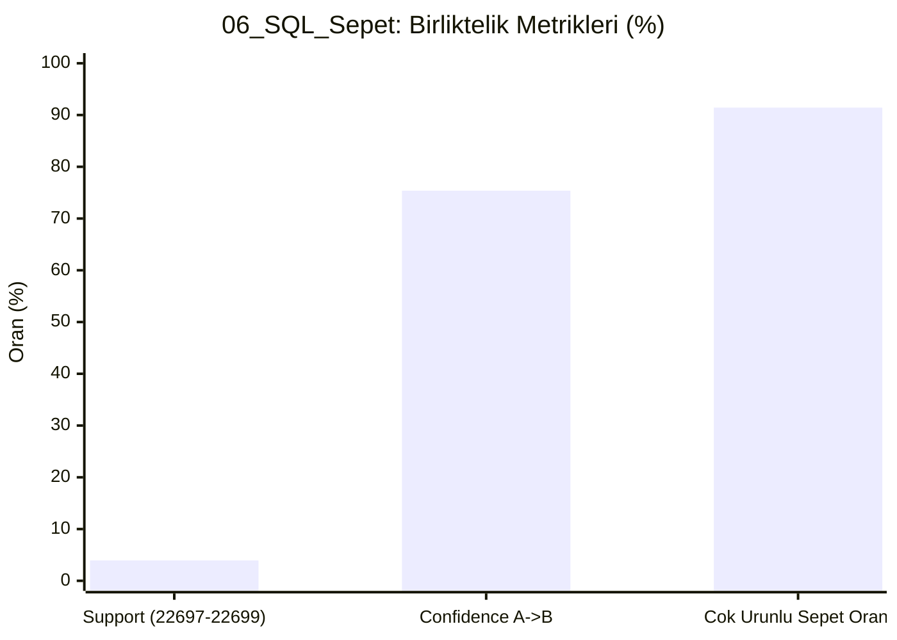

# 📊 06_SQL_Sepet — SQL sepet analizi

## 📌 Proje Özeti ve KPI Doğrulaması (`CHECKS.json` & `RESULTS.md`)
- **Veri Kaynağı ve Kapsam:** UCI Online Retail (17,582 Fatura)
- **Temel KPI ve Doğrulama Bulgusu:** 16,075 çok ürünlü fatura (%91.43); 244,908 benzersiz çift içinden 1,770 aday çift; 22697–22699 çiftinde 692 sipariş, %3.94 support, %75.38 confidence.
- **Analitik Karar Kuralı:** Yeterli support ve lift gösteren çiftlerde kontrollü çapraz satış deneyi tasarla; lift doğrudan satış artışı değildir.

## 📈 Etkileşimli Grafik Görünümü (GitHub Mermaid)

## 📁 Klasör Bileşenleri
- `dashboard.png`: Yüksek çözünürlüklü Power BI gösterge paneli çıktısı
- `data/`: Modele aktarılan CSV veri tabloları
- `analysis_evidence/`: `METHOD.md`, `RESULTS.md` ve `summary.json` kanıt dosyaları
- `CHECKS.json`: Beklenen KPI kart değerleri ve şema doğrulama sonuçları
- `06_SQL_Sepet.pbip`, `06_SQL_Sepet.Report/`, `06_SQL_Sepet.SemanticModel/`: Power BI proje ve veri modeli dosyaları
