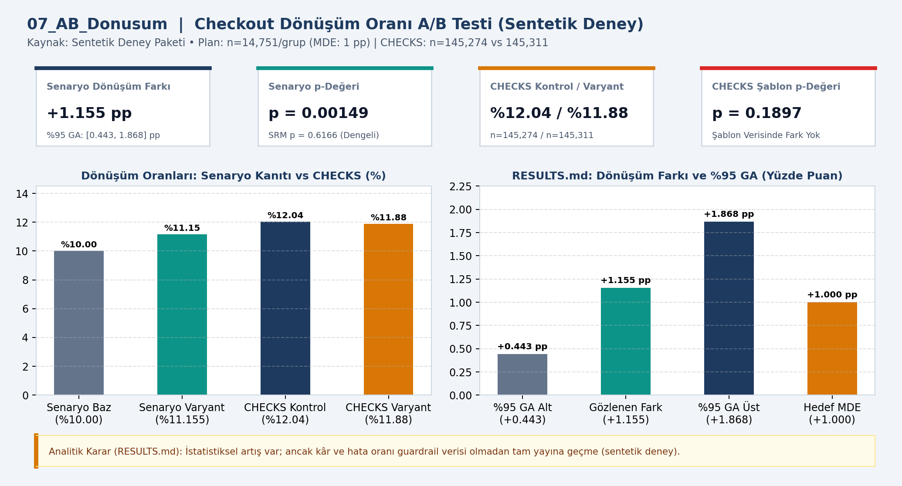
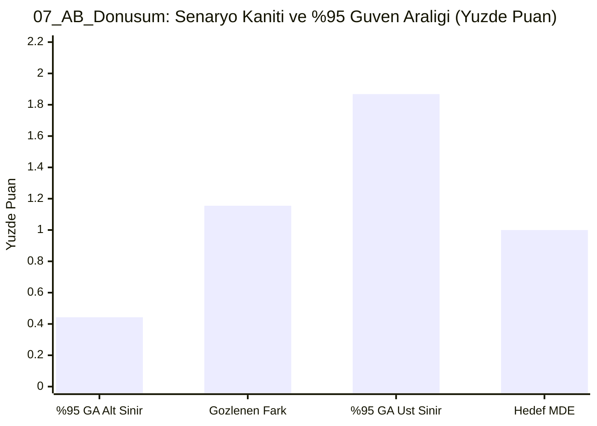

# 📊 07_AB_Donusum — Checkout A/B testi

## 📌 Proje Özeti ve KPI Doğrulaması (`CHECKS.json` & `RESULTS.md`)
- **Veri Kaynağı ve Kapsam:** Sentetik deney (n=14,751/grup)
- **Temel KPI ve Doğrulama Bulgusu:** Senaryo kanıtında +1.155 yüzde puan artış (%95 GA [0.443, 1.868], p=0.00149, SRM p=0.6166); CHECKS şablon kontrol p=0.1897.
- **Analitik Karar Kuralı:** İstatistiksel artış mevcuttur; ancak kâr ve hata oranı guardrail verisi doğrulanmadan tam yayına geçilmemelidir.

## 📈 Etkileşimli Grafik Görünümü (GitHub Mermaid)

## 📁 Klasör Bileşenleri
- `dashboard.png`: Yüksek çözünürlüklü Power BI gösterge paneli çıktısı
- `data/`: Modele aktarılan CSV veri tabloları
- `analysis_evidence/`: `METHOD.md`, `RESULTS.md` ve `summary.json` kanıt dosyaları
- `CHECKS.json`: Beklenen KPI kart değerleri ve şema doğrulama sonuçları
- `07_AB_Donusum.pbip`, `07_AB_Donusum.Report/`, `07_AB_Donusum.SemanticModel/`: Power BI proje ve veri modeli dosyaları
