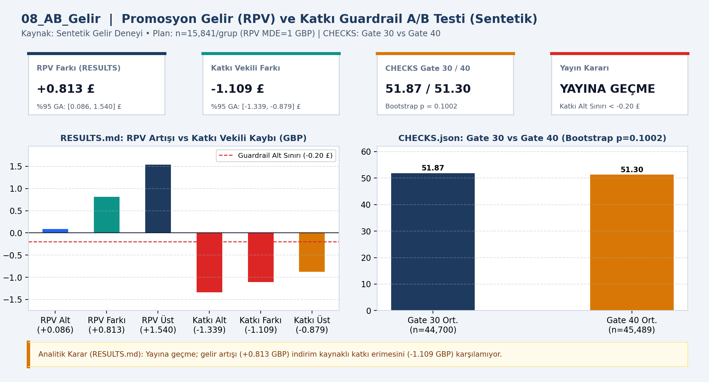
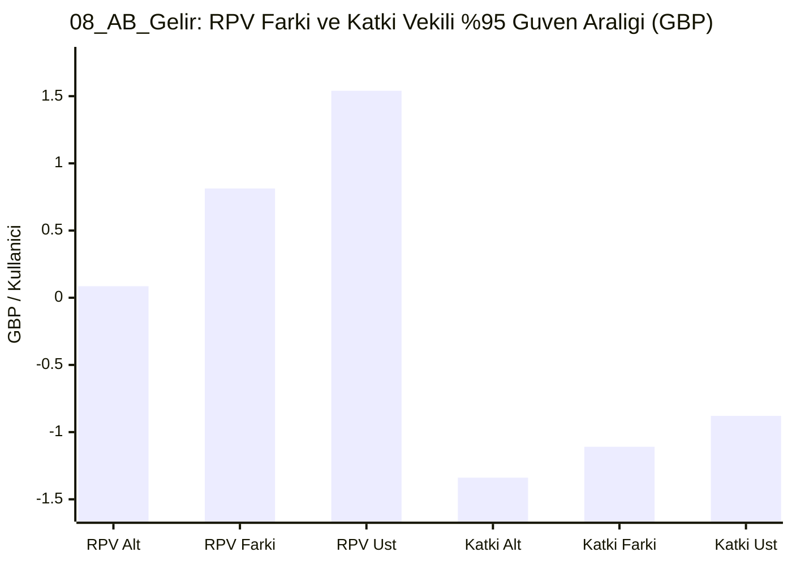

# 📊 08_AB_Gelir — Promosyon A/B testi

## 📌 Proje Özeti ve KPI Doğrulaması (`CHECKS.json` & `RESULTS.md`)
- **Veri Kaynağı ve Kapsam:** Sentetik deney (n=15,841/grup)
- **Temel KPI ve Doğrulama Bulgusu:** RPV farkı +0.813 GBP (%95 GA [0.086, 1.540]) iken katkı vekili farkı -1.109 GBP (%95 GA [-1.339, -0.879]); CHECKS Gate 30 vs 40 p=0.1002.
- **Analitik Karar Kuralı:** Yayına geçme; RPV artışına rağmen katkı vekili alt sınırı (-1.339 GBP) -0.20 GBP ekonomik guardrail sınırının altındadır.

## 📈 Etkileşimli Grafik Görünümü (GitHub Mermaid)

## 📁 Klasör Bileşenleri
- `dashboard.png`: Yüksek çözünürlüklü Power BI gösterge paneli çıktısı
- `data/`: Modele aktarılan CSV veri tabloları
- `analysis_evidence/`: `METHOD.md`, `RESULTS.md` ve `summary.json` kanıt dosyaları
- `CHECKS.json`: Beklenen KPI kart değerleri ve şema doğrulama sonuçları
- `08_AB_Gelir.pbip`, `08_AB_Gelir.Report/`, `08_AB_Gelir.SemanticModel/`: Power BI proje ve veri modeli dosyaları
