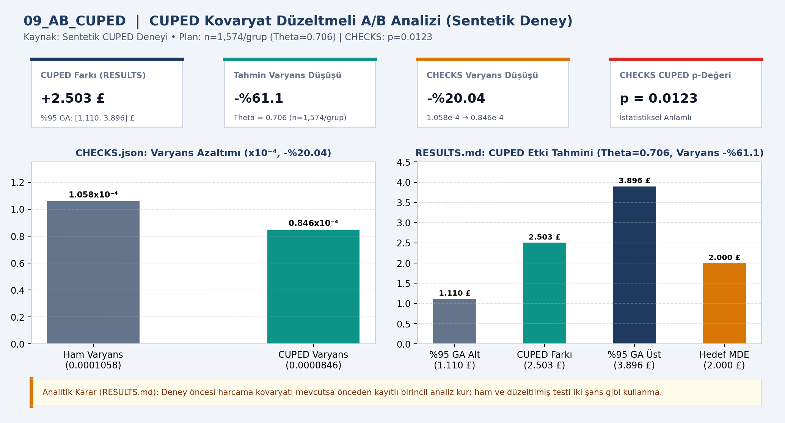
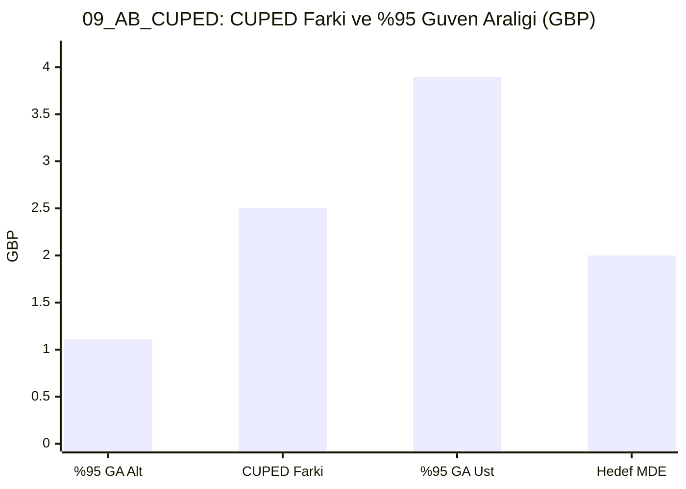

# 📊 09_AB_CUPED — CUPED analizi

## 📌 Proje Özeti ve KPI Doğrulaması (`CHECKS.json` & `RESULTS.md`)
- **Veri Kaynağı ve Kapsam:** Sentetik deney (Theta=0.706)
- **Temel KPI ve Doğrulama Bulgusu:** CUPED düzeltmeli fark +2.503 GBP (%95 GA [1.110, 3.896], n=1,574/grup); tahmin varyansında %61.1 (CHECKS ham->CUPED -%20.04, p=0.0123) azalma.
- **Analitik Karar Kuralı:** Deney öncesi harcama kovaryatı mevcutsa önceden kayıtlı birincil analiz olarak kullanılmalıdır.

## 📈 Etkileşimli Grafik Görünümü (GitHub Mermaid)

## 📁 Klasör Bileşenleri
- `dashboard.png`: Yüksek çözünürlüklü Power BI gösterge paneli çıktısı
- `data/`: Modele aktarılan CSV veri tabloları
- `analysis_evidence/`: `METHOD.md`, `RESULTS.md` ve `summary.json` kanıt dosyaları
- `CHECKS.json`: Beklenen KPI kart değerleri ve şema doğrulama sonuçları
- `09_AB_CUPED.pbip`, `09_AB_CUPED.Report/`, `09_AB_CUPED.SemanticModel/`: Power BI proje ve veri modeli dosyaları
