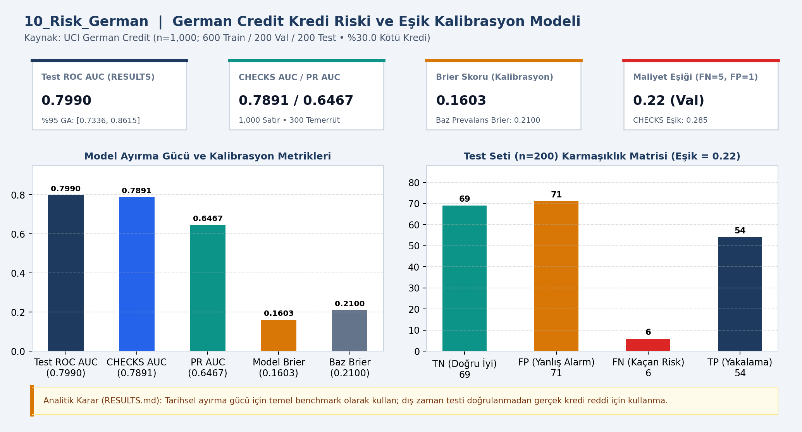
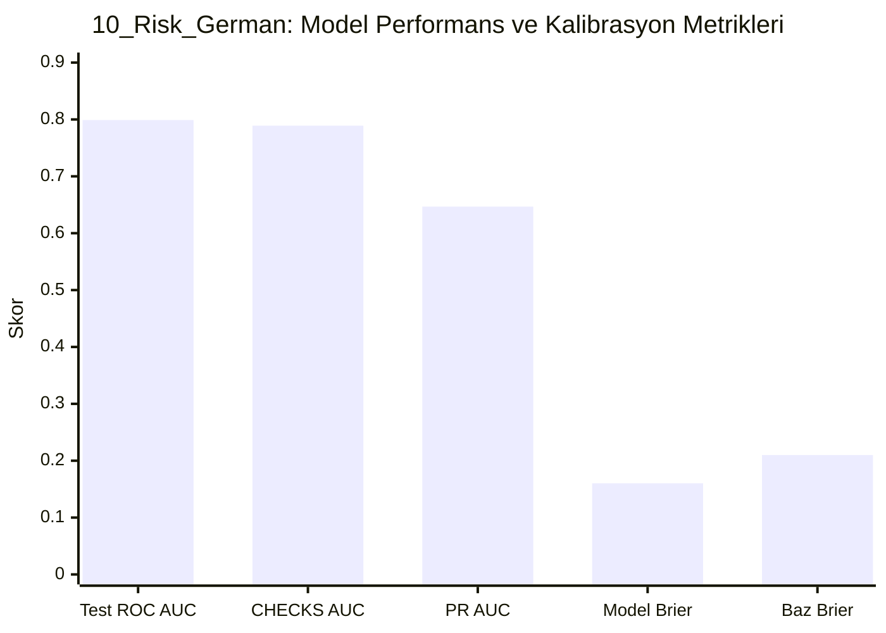

# 📊 10_Risk_German — German Credit risk modeli

## 📌 Proje Özeti ve KPI Doğrulaması (`CHECKS.json` & `RESULTS.md`)
- **Veri Kaynağı ve Kapsam:** UCI German Credit (n=1,000)
- **Temel KPI ve Doğrulama Bulgusu:** 600/200/200 bölünme, %30.0 kötü kredi; Test ROC AUC 0.7990 (CHECKS 0.7891), PR AUC 0.6467, Brier 0.1603 (baz 0.2100), eşik 0.22 (TN=69, FP=71, FN=6, TP=54).
- **Analitik Karar Kuralı:** Tarihsel ayırma gücü için temel benchmark olarak kullanılmalı; dış zaman doğrulaması olmadan otomatik kredi reddi yapılmamalıdır.

## 📈 Etkileşimli Grafik Görünümü (GitHub Mermaid)

## 📁 Klasör Bileşenleri
- `dashboard.png`: Yüksek çözünürlüklü Power BI gösterge paneli çıktısı
- `data/`: Modele aktarılan CSV veri tabloları
- `analysis_evidence/`: `METHOD.md`, `RESULTS.md` ve `summary.json` kanıt dosyaları
- `CHECKS.json`: Beklenen KPI kart değerleri ve şema doğrulama sonuçları
- `10_Risk_German.pbip`, `10_Risk_German.Report/`, `10_Risk_German.SemanticModel/`: Power BI proje ve veri modeli dosyaları
