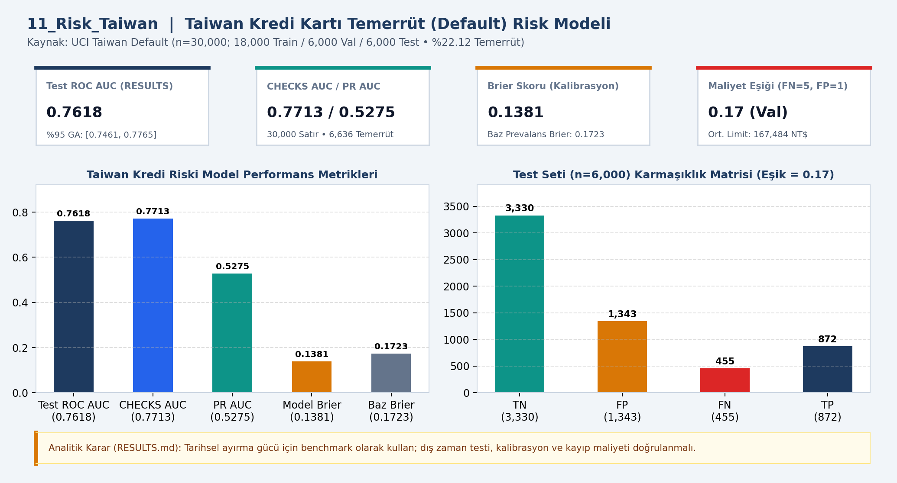
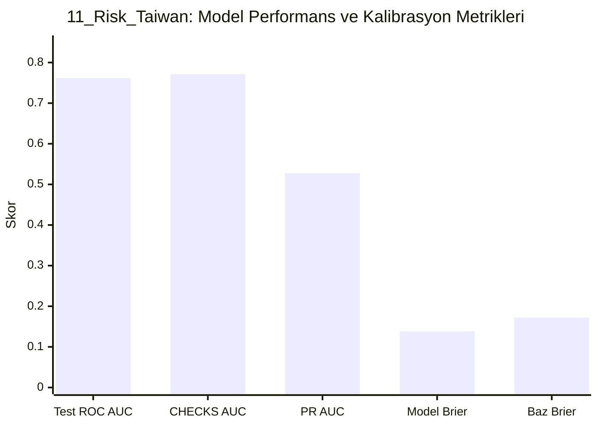

# 📊 11_Risk_Taiwan — Taiwan kredi riski

## 📌 Proje Özeti ve KPI Doğrulaması (`CHECKS.json` & `RESULTS.md`)
- **Veri Kaynağı ve Kapsam:** UCI Taiwan Default (n=30,000)
- **Temel KPI ve Doğrulama Bulgusu:** 18k/6k/6k bölünme, %22.12 temerrüt (6,636 kişi); Test ROC AUC 0.7618 (CHECKS 0.7713), PR AUC 0.5275, Brier 0.1381 (baz 0.1723), eşik 0.17 (TN=3330, FP=1343, FN=455, TP=872).
- **Analitik Karar Kuralı:** Tarihsel ayırma gücü için benchmark olarak kullanılmalı; dış zaman testi, kalibrasyon ve kayıp maliyeti doğrulanmalıdır.

## 📈 Etkileşimli Grafik Görünümü (GitHub Mermaid)

## 📁 Klasör Bileşenleri
- `dashboard.png`: Yüksek çözünürlüklü Power BI gösterge paneli çıktısı
- `data/`: Modele aktarılan CSV veri tabloları
- `analysis_evidence/`: `METHOD.md`, `RESULTS.md` ve `summary.json` kanıt dosyaları
- `CHECKS.json`: Beklenen KPI kart değerleri ve şema doğrulama sonuçları
- `11_Risk_Taiwan.pbip`, `11_Risk_Taiwan.Report/`, `11_Risk_Taiwan.SemanticModel/`: Power BI proje ve veri modeli dosyaları
