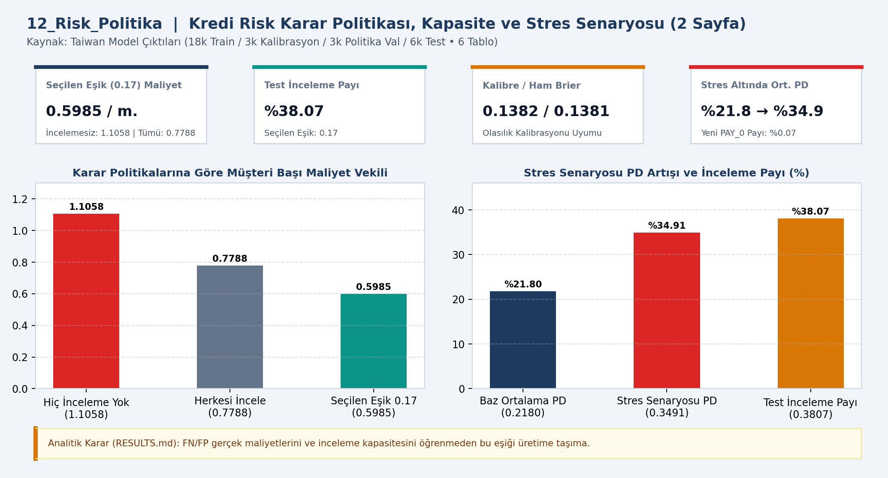
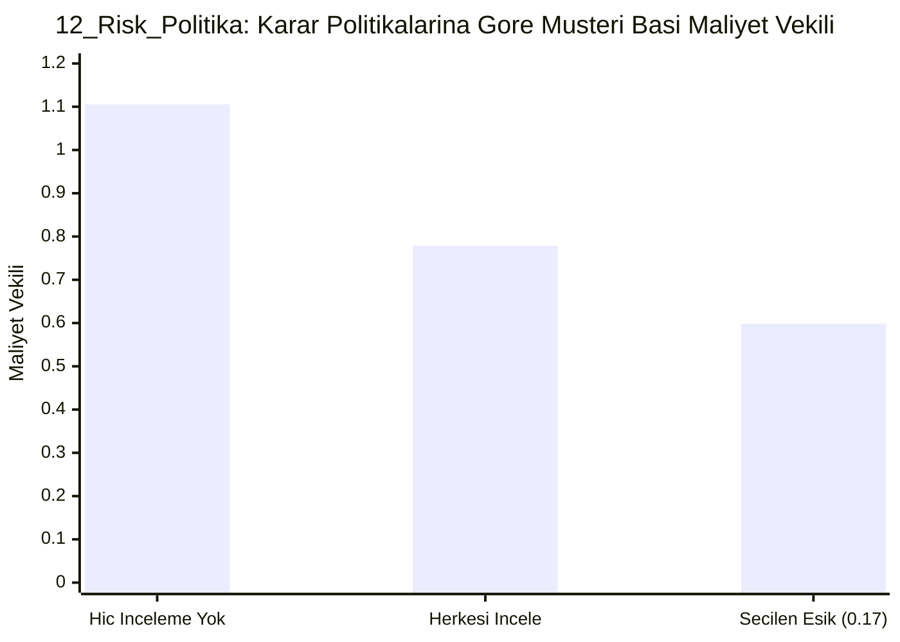

# 📊 12_Risk_Politika — Risk politikası ve stres

## 📌 Proje Özeti ve KPI Doğrulaması (`CHECKS.json` & `RESULTS.md`)
- **Veri Kaynağı ve Kapsam:** Taiwan Model Çıktıları (2 Sayfa)
- **Temel KPI ve Doğrulama Bulgusu:** 18k/3k/3k/6k bölünme; seçilen eşik 0.17 ile %38.07 inceleme payı ve 0.5985 müşteri başı maliyet vekili (incelemesiz: 1.1058, tümü: 0.7788). Stres altında ort. PD: 0.2180 → 0.3491.
- **Analitik Karar Kuralı:** Gerçek FN/FP maliyetleri ve operasyonel inceleme kapasitesi doğrulanmadan bu eşik üretime taşınmamalıdır.

## 📈 Etkileşimli Grafik Görünümü (GitHub Mermaid)

## 📁 Klasör Bileşenleri
- `dashboard.png`: Yüksek çözünürlüklü Power BI gösterge paneli çıktısı
- `data/`: Modele aktarılan CSV veri tabloları
- `analysis_evidence/`: `METHOD.md`, `RESULTS.md` ve `summary.json` kanıt dosyaları
- `CHECKS.json`: Beklenen KPI kart değerleri ve şema doğrulama sonuçları
- `12_Risk_Politika.pbip`, `12_Risk_Politika.Report/`, `12_Risk_Politika.SemanticModel/`: Power BI proje ve veri modeli dosyaları
