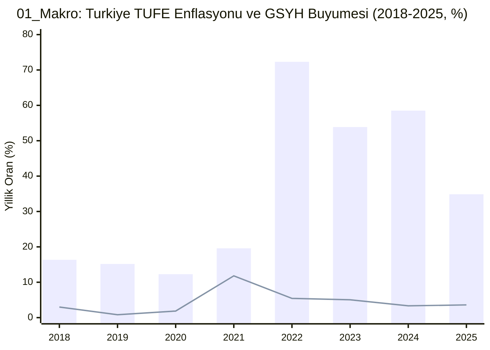
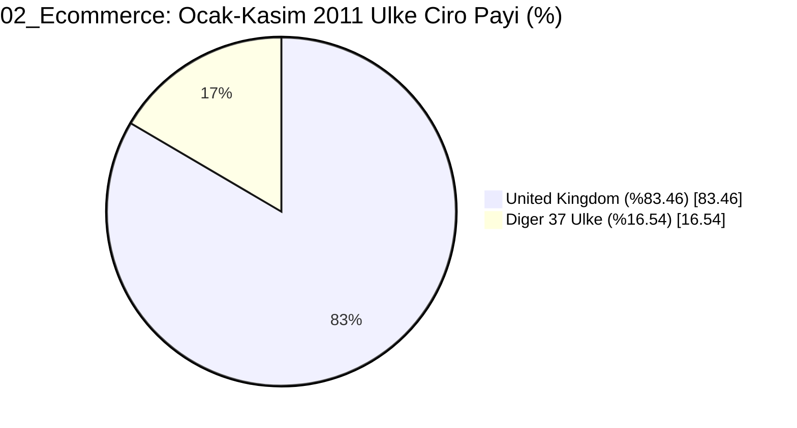
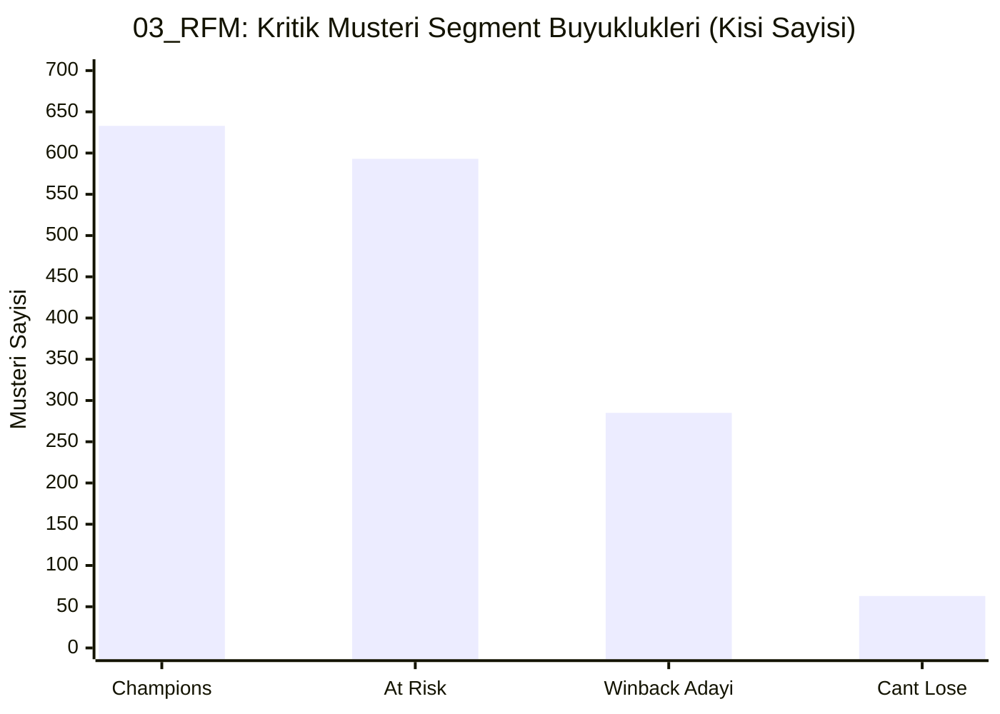
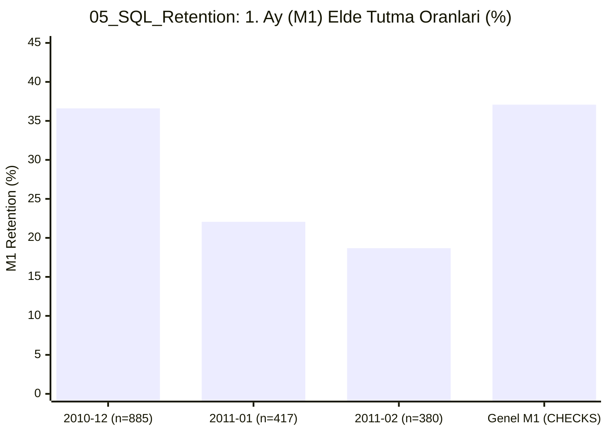
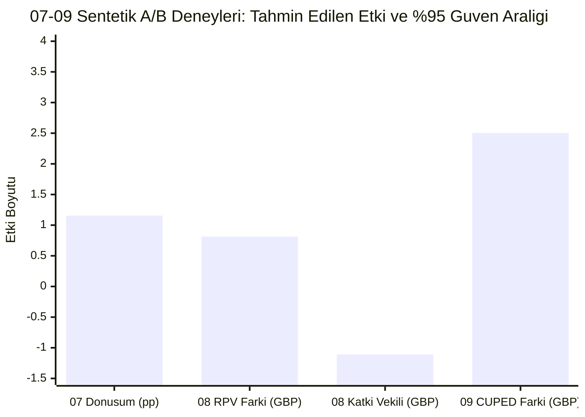
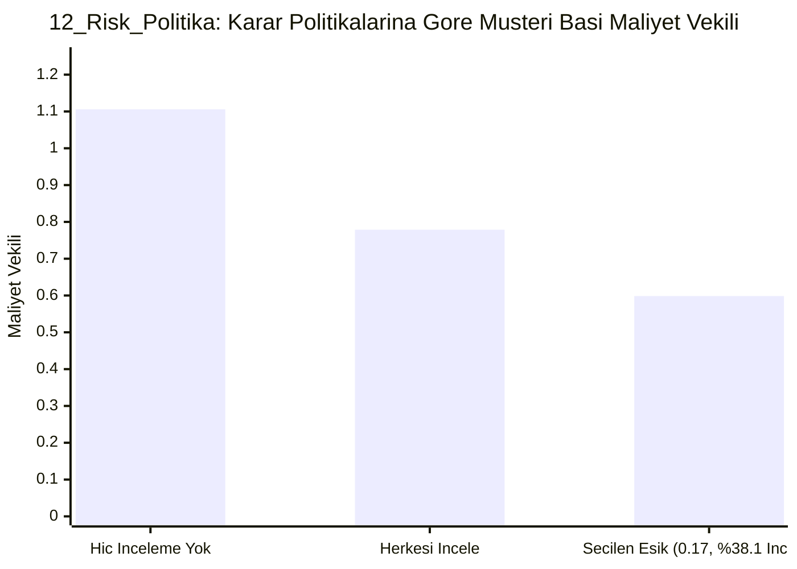

# Power BI analiz portföyü — 12 rapor taslağı

Bu depo, 12 veri analizi projesinin Power BI kaynak dosyalarını ve denetlenebilir analiz çıktılarını içerir. `*.pbip` dosyaları düzenlenebilir **taslaktır**; bu ortamda Power BI Desktop çalıştırılamadığı için açılış ve görsel işleme doğrulaması yapılmamıştır. `01_Makro.pbip` taslağının kullanıcının Windows Desktop'ında yükleme hatası verdiği bildirilmiştir. Bu dosyaları tamamlanmış veya yayımlanmış rapor diye sunmayın.

| Sıra | Proje | Veri/analiz | Power BI durumu |
|---|---|---|---|
| 01 | Türkiye makro göstergeleri | World Bank WDI | PBIP taslağı; Desktop'ta hata bildirildi |
| 02 | E-ticaret satış analizi | UCI Online Retail | PBIP taslağı |
| 03 | RFM müşteri segmentleri | UCI Online Retail | PBIP taslağı |
| 04 | SQL satış büyümesi | Açık e-ticaret verisi | PBIP taslağı |
| 05 | SQL kohort ve retention | Açık e-ticaret verisi | PBIP taslağı |
| 06 | SQL sepet analizi | Açık e-ticaret verisi | PBIP taslağı |
| 07 | Checkout A/B testi | Sentetik deney | PBIP taslağı |
| 08 | Promosyon A/B testi | Sentetik deney | PBIP taslağı |
| 09 | CUPED analizi | Sentetik deney | PBIP taslağı |
| 10 | German Credit risk modeli | UCI German Credit | PBIP taslağı |
| 11 | Taiwan kredi riski | UCI Taiwan Default | PBIP taslağı |
| 12 | Risk politikası ve stres | Model çıktıları | PBIP taslağı |

Her proje klasöründe `data/` aktarıma hazır CSV tablolarını, `analysis_evidence/` yöntem ve sonuçları, `CHECKS.json` beklenen kontrol değerlerini, `.pbip` proje girişini, `.Report/` rapor tanımını, `.SemanticModel/` modeli içerir. `RAPOR_KARTI.md` bulunan projelerde özet ve sınırlar açıklanır.

## GitHub'a gerçek Power BI raporu ekleme

1. Her projeyi Windows Power BI Desktop'ta açıp veri yenileme, görseller ve filtreleri kontrol edin. Taslak açılmazsa `data/` CSV dosyalarıyla yeni bir rapor kurun.
2. Çalışan raporu `<proje>/final/<proje>.pbix` olarak kaydedin. Desktop'ın raporu gerçekten yeniden açtığını doğrulayın.
3. Yalnızca başarıyla doğrulanan proje için durum satırını güncelleyin. Service'te yayımlarsanız gerçek URL'yi ekleyin; yer tutucu bağlantı koymayın.
4. GitHub'a gönderirken `.pbix` boyutunu ve kaynak verinin paylaşım koşullarını kontrol edin. Bu paketteki A/B verileri sentetiktir.

İlk makro raporunun World Bank API sorgusu Windows Desktop'ta başarıyla yüklenmiştir; ancak bu çalışma alanına kaydedilmiş `.pbix` dosyası aktarılmamıştır. Dolayısıyla bu depodaki ilk `.pbip`, kullanıcının çalışan raporunun kopyası değildir.

**Doğrulama kapsamı:** `DOGRULAMA.md` statik şema ve bağ kontrolünü anlatır. Power BI Desktop'ta açılış, M/DAX yürütme, ekran görüntüsü ve Service yayını doğrulanmadı.
## 📊 12 Proje Görsel Analitik Raporları ve Grafik Çıktıları

Bu bölüm, depodaki 12 projenin (`01_Makro` – `12_Risk_Politika`) gömülü veri setlerinden (`SNAPSHOT.json`, `data/*.csv`), `CHECKS.json` doğrulama şemalarından ve `analysis_evidence/RESULTS.md` çıktılarından üretilen görsel grafikleri, KPI kartlarını ve analitik karar kurallarını içerir.

### 1. `01_Makro` — Türkiye Makroekonomik Göstergeleri (2000–2025)
* **Veri Kaynağı:** World Bank WDI (26 Yıllık Gömülü Seri, Son Ortak Yıl: **2025**)
* **KPI Kartları (`CHECKS.json`):** Son Yıl: `2025` | TÜFE Enflasyonu: `%34.88` | GSYH Büyümesi: `%3.60` | İşsizlik Oranı: `%8.52`
* **Analitik Karar (`RESULTS.md`):** Kurumsal bütçe senaryolarını tek bir makro göstergeye bağlama; nominal satış artışı ile reel büyümeyi birbirinden ayır.

| Yıl | TÜFE Enflasyonu (%) | GSYH Büyümesi (%) | İşsizlik Oranı (%) | Enflasyon Görsel Bar |
| :--- | :---: | :---: | :---: | :--- |
| **2021** | %19.60 | %11.81 | %11.97 | `█████░░░░░░░░░░░░░░░` |
| **2022** | %72.31 | %5.44 | %10.47 | `████████████████████` |
| **2023** | %53.86 | %5.05 | %9.39 | `███████████████░░░░░` |
| **2024** | %58.51 | %3.33 | %8.80 | `████████████████░░░░` |
| **2025** | **%34.88** | **%3.60** | **%8.52** | `██████████░░░░░░░░░░` |

---

### 2. `02_Ecommerce` — E-Ticaret Satış ve Ülke Yoğunlaşma Analizi
* **Veri Kaynağı:** UCI Online Retail (38 Ülke)
* **KPI Kartları:** Model Satış (`CHECKS.json`): `8,911,407.39 GBP` (25,900 fatura, 4,372 müşteri) | Ocak–Kasım 2011 Ciro (`RESULTS.md`): `9,182,867.74 GBP` (17,582 sipariş, Ortalama Sepet AOV: `522.29 GBP`)
* **Analitik Karar (`RESULTS.md`):** Birleşik Krallık payı **%83.46** (`CHECKS.json` UK: `8,187,806.42 GBP`). Yüksek paylı pazarda operasyon sürekliliğini öncele; küçük pazarlara yatırım kararı için kâr ve edinim maliyeti topla.

---

### 3. `03_RFM` — RFM Müşteri Segmentasyonu ve Geri Kazanım Pilotu
* **Veri Kaynağı:** UCI Online Retail (Referans Snapshot: `2011-12-10`, Toplam RFM Monetary: `8,887,208.89 GBP`)
* **KPI Kartları:** Toplam Müşteri: `4,339` (`RESULTS.md` bilinen: `4,338`) | Champions: `633` | At Risk: `593` | Can't Lose: `63` | Geri Kazanım Pilot Adayı: `285`
* **Analitik Karar (`RESULTS.md`):** 285 geri kazanım adayında randomize kontrollü bir geri kazanım pilotu tasarla; önceden kampanya getirisi veya churn olasılığı iddia etme.

---

### 4. `04_SQL_Buyume` — SQL Satış Büyümesi (`CTE`, `JOIN`, `LAG`, `DENSE_RANK`)
* **KPI Kartları (`CHECKS.json` & `RESULTS.md`):** Dönem: `2010-12 – 2011-12` (13 Ay) | Toplam Ciro: `9,749,138.20 GBP` | Zirve Ay: `2011-11` (`1,461,756.24 GBP`) | Sorgu Çıktısı: `261 satır` (`0.009 sn`)
* **Örnek Kesit:** `2011-01` United Kingdom cirosu `559,975.83 GBP`, `971` sipariş, ülke payı `%81.18`.
* **Analitik Karar:** Ülke payını aylık değişimle birlikte izle; tek pazar yoğunlaşmasını azaltma kararı için ülke bazlı kâr ve edinim maliyeti gerekir.

---

### 5. `05_SQL_Retention` — SQL Kohort ve Müşteri Elde Tutma Analizi
* **KPI Kartları (`CHECKS.json` & `RESULTS.md`):** Toplam Kohort: `13` (Boyut: min `41` – maks `885` müşteri) | Genel M1 Elde Tutma: `%37.08` (`2010-12` CHECKS M1: `%37.06`)
* **Analitik Karar (`RESULTS.md`):** Küçük veya düşen kohortlarda edinim kanalı ve stok bulunurluğunu araştır. `2010-12` başlangıç kohortu sol sansürlüdür.

---

### 6. `06_SQL_Sepet` — SQL Sepet ve Birliktelik (Market Basket) Analizi
* **KPI Kartları (`CHECKS.json` & `RESULTS.md`):** Geçerli Fatura: `17,582` | Çok Ürünlü Sepet: `16,075` (`%91.43`) | Benzersiz Ürün Çifti: `244,908` | Filtrelenen Aday Çift: `1,770` (İlk 30 çift raporlanır)
* **Öne Çıkan Çiftler:** `22697–22699` ürün çifti (`692` ortak sipariş, Support `%3.94`, Confidence `%75.38`); `CHECKS.json` en yüksek çift (`KEY FOB`): `827`.
* **Analitik Karar:** Yeterli support ve lift gösteren çiftlerde kontrollü çapraz satış deneyi tasarla; lift doğrudan satış artışı değildir.

---

### 7–9. Sentetik A/B Testleri ve CUPED Varyans Azaltımı (`07_AB_Donusum`, `08_AB_Gelir`, `09_AB_CUPED`)

| Proje Kodu | Gömülü Şablon Kontrolü (`CHECKS.json`) | Senaryo Kanıtı ve Karar Kuralı (`RESULTS.md`) | Yayın Kararı |
| :--- | :--- | :--- | :---: |
| **`07_AB_Donusum`** | Kontrol (`n=145,274`): `%12.04` vs Varyant (`n=145,311`): `%11.88` (`p=0.1897`) | Plan: `14,751/grup` (`%10→%11` MDE). Gözlenen fark: **`+1.155 puan`** (`%95 GA [0.443, 1.868]`, `p=0.00149`, SRM `p=0.6166`) | ⚠️ **Guardrail Bekle** |
| **`08_AB_Gelir`** | Gate 30 (`n=44,700`): `51.87` vs Gate 40 (`n=45,489`): `51.30` (`p=0.1002`) | Plan: `15,841/grup`. RPV farkı: **`+0.813 GBP`** (`[0.086, 1.540]`), Katkı vekili: **`-1.109 GBP`** (`[-1.339, -0.879] < -0.20`) | ❌ **Yayına Geçme** |
| **`09_AB_CUPED`** | Ham varyans `0.0001058` → CUPED `0.0000846` (**`-%20.04`**, `p=0.0123`) | Plan: `1,574/grup`, `Theta=0.706`. CUPED farkı: **`+2.503 GBP`** (`%95 GA [1.110, 3.896]`), tahmin varyansı **`-%61.1`** | ✅ **Birincil Analiz Kur** |

---

### 10–12. Kredi Riski Modelleri ve Politika Stres Testi (`10_Risk_German`, `11_Risk_Taiwan`, `12_Risk_Politika`)

| Proje Kodu | Veri Seti ve Temerrüt Oranı | Ayırma Gücü (`ROC AUC` / `PR AUC`) | Kalibrasyon (`Brier`) ve Eşik | Karmaşıklık Matrisi & Politika Çıktısı |
| :--- | :--- | :--- | :--- | :--- |
| **`10_Risk_German`** | `1,000` satır (`600/200/200`) `%30.0` kötü kredi (`300`) | Test ROC AUC: **`0.7990`** (`[0.7336, 0.8615]`) CHECKS AUC: `0.7891` \| PR AUC: `0.6467` | Brier: **`0.1603`** (Baz: `0.2100`) Val Eşik: `0.22` (CHECKS: `0.285`) | Test (`n=200`): `TN=69, FP=71, FN=6, TP=54` Ort. kredi vadesi: `20.90 ay` |
| **`11_Risk_Taiwan`** | `30,000` satır (`18k/6k/6k`) `%22.12` temerrüt (`6,636`) | Test ROC AUC: **`0.7618`** (`[0.7461, 0.7765]`) CHECKS AUC: `0.7713` \| PR AUC: `0.5275` | Brier: **`0.1381`** (Baz: `0.1723`) Val Eşik: `0.17` (CHECKS: `0.215`) | Test (`n=6,000`): `TN=3330, FP=1343, FN=455, TP=872` Ort. kredi limiti: `167,484.32 NT$` |
| **`12_Risk_Politika`** | `30,000` satır (`18k/3k/3k/6k`) 2 Rapor Sayfası, 6 Tablo | German AUC: `0.7891` Taiwan AUC: `0.7713` | Kalibre Brier: `0.1382` Ham Brier: `0.1381` \| Eşik: **`0.17`** | İnceleme payı **`%38.07`** ile müşteri başı maliyet vekili **`0.5985`** (İncelemesiz: `1.1058`, Tümü: `0.7788`). Stres PD: **`0.2180 → 0.3491`** |

